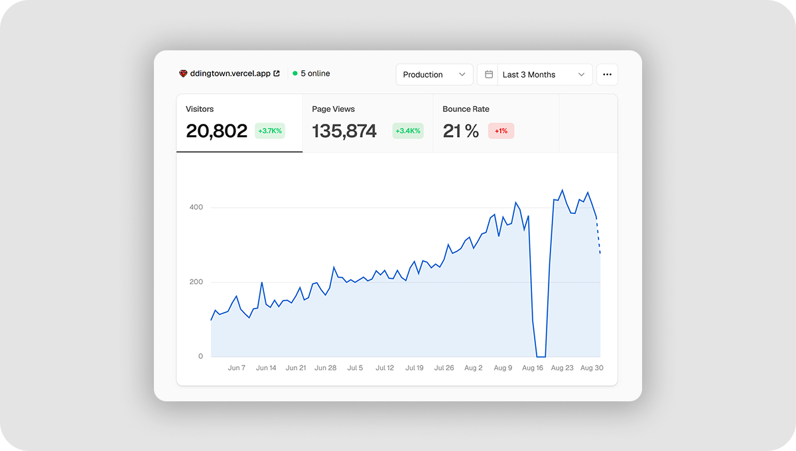
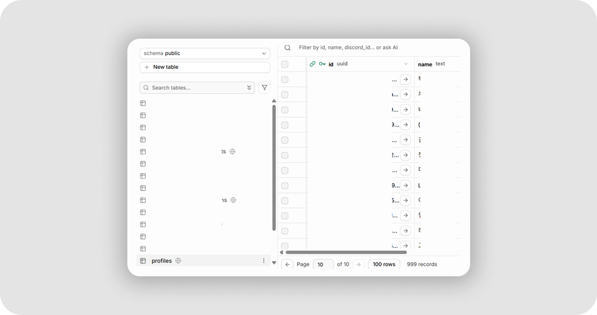
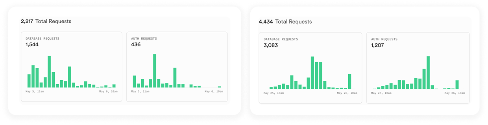

*[띵타운](https://ddingtown.vercel.app) 성장 기록!!*  
[카페 소개글](https://cafe.naver.com/ddingtycoon/13582)

**v0.1부터 v2.28까지의 기록**

띵타운은 마인크래프트 사설 서버 '띵타이쿤'의 팬사이트다.

띵타이쿤을 한창 열심히 하던 두 달째쯤 개발을 시작했었다.

그때 나는 광부에 푹 빠져 있었다. 열심히 모은 돈으로 돌 1틱 곡괭이를 사려고 했는데, 얼마에 사야 하는지 알아보는 것부터 일이었다.
디스코드 판매 게시판을 계속 들락날락하면서 시세를 확인하는 것도 힘들었다..

~ 시세를 한눈에 볼 수 없을까? 라는 생각으로 띵타운 개발 시작 ~

처음엔 거래소가 목적이었는데, 지금은 채광·재배·해양·사냥 직업별 계산기·정보 모음 사이트가 됐다. v0.1에서 시작해서 지금은 v2.28까지 왔다.

&nbsp;

## 수치

최근 3개월동안 **20,832명** 방문 *(Vercel Analytics, 중복 포함)*  

회원수 **999**명 *(Supabase Database)*

 요청수는 5월엔 **2,217**건이었는데 6월엔 **4,607**건으로 한 달 만에 두 배가 넘었다.

---

## 여담

내가 쓰려고 정말 편하게 만들어보자는 생각으로 만든 건데, 솔직히 이렇게 많은 분들이 써주실 줄은 몰랐다 ㅠ

처음에 인증 한 건 올라올 때마다 진짜 너무 소중했는데, 벌써 1000명이 다 되어간다.

사이트 특성상 게임 접속자 수만큼이 한계일 거라 생각했는데, 생각보다 많이 들어와서 아직도 신기하다.

쓰는 사람이 생기니까 업데이트도 계속 하게 된다~!

테스터가 없어서 디스코드에 올렸던 적도 있다. 해양인이 너무 없어서.. 

당시 해양은 진입장벽이 있고, 연금도 복잡했고, 나도 막 해양에 입문한 참이었다.

보상도 걸어봤는데.. Github contributors 페이지에서 모티브를 얻은 '도움 주신 분들' 칸이다.

다섯 분이 의견과 피드백을 내주셨고, 덕분에 정확하고 더 편리하게 기능을 완성할 수 있었던 것 같다. (이 글을 빌려 다시 감사하다는 말씀을 전합니다!!🫶)